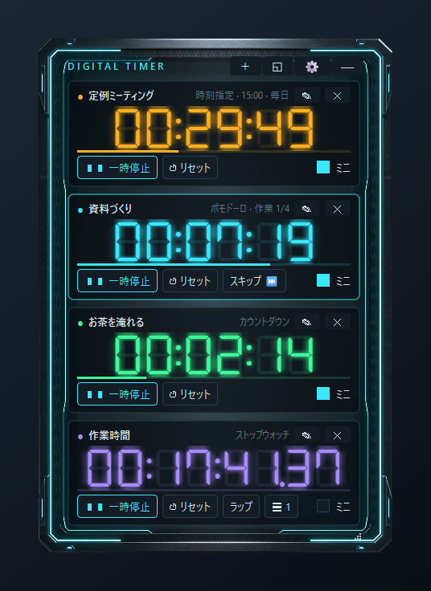
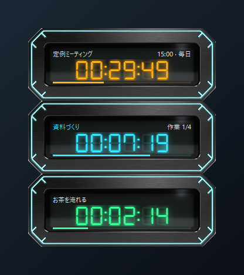
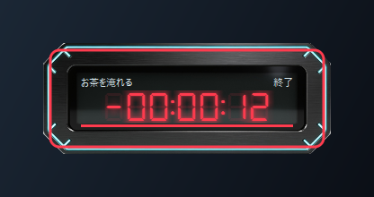
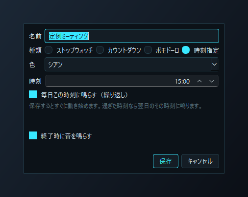

# Digital Timer

作業中の画面の隅に常駐させる、Windows 用のデジタルタイマーです。
ストップウォッチ・カウントダウン・ポモドーロ・時刻指定を好きなだけ並べて、同時に動かせます。



## できること

- **4種類のタイマー**
  - ストップウォッチ（ラップ付き）
  - カウントダウン（終わったら自動でもう一度、の繰り返しも可）
  - ポモドーロ（作業・休憩・セット数）
  - 時刻指定（「15:00 になったら鳴らす」。毎日の繰り返しも可）
- **名前と色**: タイマーごとに名前（例: 会議、休憩）と6色から選べる色を付けられます
- **常に最前面・透明度 20〜100%**: 作業の邪魔にならない濃さで画面の隅に置いておけます
- **ミニ表示**: 「ミニ」にチェックしたタイマーだけを、小さなパネルで縦に並べます
- **お知らせ**: 時間になると音・Windows の通知・赤い点滅で知らせます。終わった後は赤い数字で超過時間を数えます
- **残り1分**: 数字が琥珀色に変わります
- **グローバルショートカット**: 他のアプリを使っている最中でも、スタート・リセットなどを操作できます
- **クリック透過**: 表示したまま、下のウィンドウをクリックできます
- **保存**: タイマーと設定は自動で保存され、次回の起動で元に戻ります

| ミニ表示 | 時間になったとき | 時刻指定の設定 |
|---|---|---|
|  |  |  |

## 動かすのに必要なもの

- Windows 10 / 11
- Python 3.10 以上

## インストール

```
git clone https://github.com/BugattiAlpha/digital-timer.git
cd digital-timer
python -m venv .venv
.venv\Scripts\python -m pip install -r requirements.txt
```

## 起動

`Digital_Timer_start.bat` をダブルクリックします（コンソール画面は出ません）。
起動中にもう一度起動すると、既に動いているウィンドウが前に出ます。

## 使い方

| 操作 | 方法 |
|---|---|
| タイマーを追加 | 右上の ＋ |
| 編集 / 削除 | カード右上の ✎ / ✕ |
| 移動 | タイトルバー（ミニ表示は本体）をドラッグ |
| 大きさ | 右下の角をドラッグ |
| 透明度 | Ctrl＋マウスホイール、または ⚙ 設定のスライダー |
| ミニ表示 | ◱ ボタン。カードの「ミニ」にチェックしたタイマーが並びます。ダブルクリックで通常表示に戻ります |
| ミニ表示で操作するタイマー | パネルをクリック（名前がシアンになったものにショートカットが効きます） |
| お知らせを止める | カード（ミニ表示のパネル）をクリック、Ctrl+Alt+A、トレイメニュー |
| しまう / 終了 | ― または × でトレイへ。終了はトレイアイコンの右クリック →「終了」 |

### ショートカット（他のアプリを使っている最中でも効きます）

| 動作 | 既定 |
|---|---|
| 選択中タイマーのスタート / 一時停止 | Ctrl+Alt+S |
| リセット | Ctrl+Alt+R |
| ラップ | Ctrl+Alt+L |
| ミニ表示の切替 | Ctrl+Alt+M |
| クリック透過の切替 | Ctrl+Alt+T |
| 表示 / 非表示 | Ctrl+Alt+H |
| お知らせを止める | Ctrl+Alt+A |

他のアプリが同じキーを使っていると登録できません。⚙ 設定で「使用中」と表示されるので、別のキーに変えてください。

## 保存

設定とタイマー一覧は `%APPDATA%\DigitalTimer\state.json` に保存されます。

- 終了時に動いていたタイマーは、次回は一時停止の状態で戻ります（時刻指定は同じ時刻のまま動き続けます）
- アプリを閉じている間に時刻指定の時刻を過ぎていたら、次の起動で「過ぎていました」と知らせます
- ファイルが壊れていた場合は `state.json.bak` に退避して、初期状態で起動します

## アンインストール

このフォルダと `%APPDATA%\DigitalTimer` を削除します。

## 開発

```
.venv\Scripts\python -m pytest
```

- 画面は PySide6（Qt for Python）
- パネル・アイコン画像は Seedream 4.5（OpenRouter 経由）で生成した画像を切り抜いて使っています。
  作り直すときは環境変数 `OPENROUTER_API_KEY` に OpenRouter の API キーを設定します（生成は有料）
  （`scripts/gen_images.py` → `scripts/cutout.py` → `scripts/make_icon.py`。選定理由は `assets_ai/SELECTION.md`）
- アラーム音は `scripts/gen_sounds.py` で合成しています

## ライセンス

- このアプリのソースコード: MIT License（`LICENSE`）
- 数字のフォント DSEG7 Classic（`assets/fonts/`）: SIL Open Font License 1.1。© 2017 keshikan（https://www.keshikan.net）。
  ライセンス本文は `assets/fonts/OFL.txt`
- PySide6 はこのリポジトリに含まれていません。`pip install` で各自取得され、
  `LGPL-3.0-only OR GPL-2.0-only OR GPL-3.0-only`（いずれかを選択。ほかに商用ライセンスもあり）で提供されています（https://pypi.org/project/PySide6/）
- パネル・アイコン画像は AI（Seedream 4.5）で生成したものです
